```{=html}

```


## Overview

**GHRexplore** is an R package for exploratory analysis of temporal and
spatiotemporal health data including case counts, incidence rates, and
covariates. It provides commonly used visualizations and supports data
transformations such as temporal and spatial aggregations. The package
also offers extensive customization options for the resulting figures.
The output of all functions is a `ggplot2` object that can be further
modified if needed.

``` r
# Load GHRexplore
library(GHRexplore)

# Other necessary libraries for the vignette
library(dplyr)
library(sf)
```

## Data requirements

The data must be a long-format data frame containing a regularly spaced
time series (e.g., daily, weekly, monthly) of a single or several
spatial units. In this data frame, the time and optional spatial unit
identifiers must be included as columns.

As an example, we can have a look at the `dengue_MS` dataset included in
the package, which includes data on dengue cases from the *Mato Grosso
do Sul* state in Brazil as well as a set of relevant covariates.

``` r
data("dengue_MS")
glimpse(dengue_MS)
#> Rows: 2,640
#> Columns: 28
#> $ micro_code      <dbl> 50001, 50002, 50003, 50004, 50005, 50006, 50007, 50008…
#> $ micro_name      <chr> "Baixo Pantanal", "Aquidauana", "Alto Taquari", "Campo…
#> $ micro_name_ibge <chr> "BAIXO PANTANAL", "AQUIDAUANA", "ALTO TAQUARI", "CAMPO…
#> $ meso_code       <dbl> 5001, 5001, 5002, 5002, 5003, 5003, 5003, 5003, 5004, …
#> $ meso_name       <chr> "Pantanais Sul Mato-Grossense", "Pantanais Sul Mato-Gr…
#> $ state_code      <dbl> 50, 50, 50, 50, 50, 50, 50, 50, 50, 50, 50, 50, 50, 50…
#> $ state_name      <chr> "Mato Grosso Do Sul", "Mato Grosso Do Sul", "Mato Gros…
#> $ region_code     <dbl> 5, 5, 5, 5, 5, 5, 5, 5, 5, 5, 5, 5, 5, 5, 5, 5, 5, 5, …
#> $ region_name     <chr> "Centre-West", "Centre-West", "Centre-West", "Centre-W…
#> $ biome_code      <dbl> 3, 3, 2, 2, 2, 2, 2, 2, 2, 2, 6, 3, 3, 2, 2, 2, 2, 2, …
#> $ biome_name      <chr> "Pantanal", "Pantanal", "Cerrado", "Cerrado", "Cerrado…
#> $ ecozone_code    <dbl> 3, 3, 2, 2, 2, 2, 2, 2, 2, 2, 8, 3, 3, 2, 2, 2, 2, 2, …
#> $ ecozone_name    <chr> "Pantanal", "Pantanal", "Cerrado", "Cerrado", "Cerrado…
#> $ main_climate    <chr> "AW", "AM", "AW", "AM", "AM", "AW", "AM", "AW", "AF", …
#> $ month           <dbl> 1, 1, 1, 1, 1, 1, 1, 1, 1, 1, 1, 2, 2, 2, 2, 2, 2, 2, …
#> $ year            <dbl> 2000, 2000, 2000, 2000, 2000, 2000, 2000, 2000, 2000, …
#> $ time            <dbl> 1, 1, 1, 1, 1, 1, 1, 1, 1, 1, 1, 2, 2, 2, 2, 2, 2, 2, …
#> $ dengue_cases    <dbl> NA, NA, NA, NA, NA, NA, NA, NA, NA, NA, NA, NA, NA, NA…
#> $ population      <dbl> NA, NA, NA, NA, NA, NA, NA, NA, NA, NA, NA, NA, NA, NA…
#> $ pop_density     <dbl> NA, NA, NA, NA, NA, NA, NA, NA, NA, NA, NA, NA, NA, NA…
#> $ tmax            <dbl> 34.28429, 33.15394, 32.31370, 31.23787, 31.19907, 32.1…
#> $ tmin            <dbl> 24.00583, 23.43257, 22.61425, 21.82709, 21.29000, 21.8…
#> $ pdsi            <dbl> -1.2329962, -1.8564967, -0.7201829, -2.3979688, -0.205…
#> $ urban           <dbl> 88.31, 72.36, 84.51, 94.71, 87.29, 85.58, 84.16, 78.50…
#> $ water_network   <dbl> 88.78, 79.59, 84.29, 88.13, 86.48, 65.80, 83.69, 81.68…
#> $ water_shortage  <dbl> 0.0000, 0.1528, 0.0437, 0.1855, 0.3201, 0.1921, 0.0524…
#> $ date            <date> 2000-01-01, 2000-01-01, 2000-01-01, 2000-01-01, 2000-…
#> $ pop100000       <dbl> NA, NA, NA, NA, NA, NA, NA, NA, NA, NA, NA, NA, NA, NA…
```

In this data frame, the *date* column contains the temporal identifier
(in this case, we have monthly data where the variable *date* represents
the first day of the month) and the spatial unit identifier is
*micro\_code*. These variable names should be specified in the `time`
and `unit` arguments, respectively.

Since we have data for several spatial units, it is useful to have the
polygon geometries of the units (e.g., a geopackage, shapefile or
geojson file), loaded as an `sf` object, in order to plot cartographic
representations. The `sf` object must also contain the unit identifier
to be able to link the geometries with the data frame.

For the `dengue_MS`, the geometries are already included in the package
in the `map_MS` object:

``` r
data("map_MS")
glimpse(map_MS)
#> Rows: 11
#> Columns: 2
#> $ code     <dbl> 50001, 50002, 50003, 50004, 50005, 50006, 50007, 50008, 50009…
#> $ geometry <MULTIPOLYGON [°]> MULTIPOLYGON (((-55.60618 -..., MULTIPOLYGON (((…
```

In `map_MS`, the *code* variable corresponds to the *micro\_code* unit
identifier in the `dengue_MS` object.

> 💡 **Tip**: If you don’t have geometries for your data, a good place to
> look for them is [GADM](https://gadm.org/), [natural
> earth](https://www.naturalearthdata.com/), or
> [GeoBoundaries](https://www.geoboundaries.org/).

## Covariates, case counts, and incidence rates

In all **GHRexplore** functions, the column name of the variable to be
plotted needs to be specified with the `var` argument. Plotting
functions behave differently depending on the type of data being plotted
as defined by the `type` argument: covariates (`type='cov'`), case
counts (`type='counts'`), and incidence rates (`type='inc'`). Several
examples for each type are provided in the following sections.

To plot incidence rates, the column with the disease counts must be used
as `var` and the population must be also supplied as the `pop` argument.
By default, rates are computed per 100,000 persons, but this number can
be changed using the `pt` argument.

## Spatial and temporal aggregations

Most **GHRexplore** functions support temporal and spatial aggregations
from finer to coarser resolution. For example, you can aggregate daily
to weekly data, or aggregate small regions to larger regions.

Temporal and spatial aggregations are performed using the arguments
`aggregate_time` and `aggregate_space`, respectively. For covariates
(`type='cov'`), the aggregation function can be specified using
`aggregate_space_fun` and `aggregate_time_fun` (options include mean
(default), median, and sum). For case counts and incidence, the
aggregation function is fixed to be the sum of cases and the mean of the
population.

## Color palettes

In **GHRexplore**, color is controlled by the `palette` argument. We
included a few in-house palettes that are used as defaults depending on
the plot type:

``` r
GHR_palettes()
```


In addition to these, all color palettes included in the packages
`RColorBrewer` and `colorspace` can also be used. All available options
can be checked by running `RColorBrewer::display.brewer.all()` and
`colorspace::hcl_palettes(plot=TRUE)`.

As a few examples, the ‘Blues’ palette can be useful when plotting
precipitation-related variables, ‘Greens’ when plotting
vegetation-related variables, or ‘Blue-Red’ when displaying temperature.
When a single color is needed, a color in `colors()` or a hex code can
also be specified. In addition, the user can provide custom palettes
using a vector of hex codes to the palette argument.

> 💡 **Tip**: Palettes can be reversed by preceding them with a minus
> sign, e.g. ‘-IDE1’.

# Plot types

## Time series

`plot_timeseries` produces time series plots of covariates, case counts,
or incidence rates. It allows for spatial and temporal aggregations,
plotting single or multiple time series of different units
simultaneously (using facets or colors), y-axis transformations, and
axis and title labeling.

We start by plotting the time series data for minimum temperature (note
`type="cov"`) for all the 11 spatial units in `dengue_MS`:

``` r
plot_timeseries(
  dengue_MS,
  var = "tmin",
  type = "cov",
  var_label = "Minimum temp.",
  time = "date",
  unit = "micro_code"
)
```

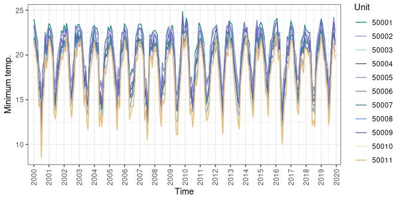

Since 11 spatial units are quite a lot for a single graph, we can use
`facet = TRUE` to display them in different panels:

``` r
plot_timeseries(
  dengue_MS,
  var = "tmin",
  type = "cov",
  var_label = "Minimum temp.",
  time = "date",
  unit = "micro_code",
  facet = TRUE
)
```

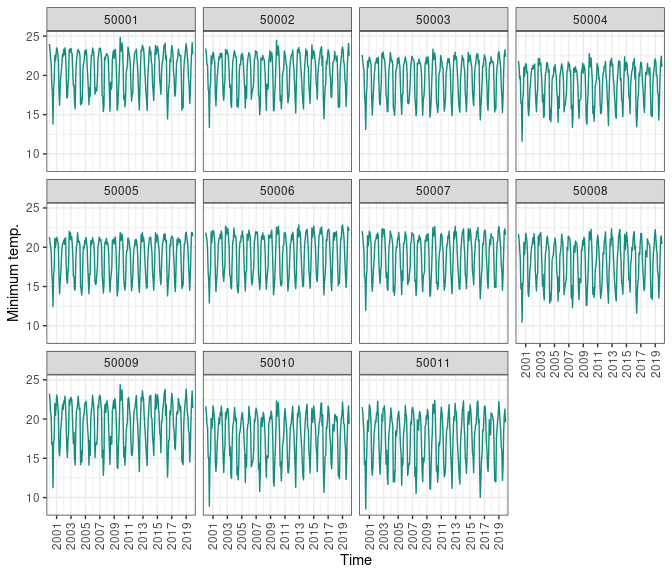

Another possible strategy is to keep the 11 units, but highlight the one
we are interested in using the `highlight` argument by setting it to the
unit identifier we want to highlight:

``` r
plot_timeseries(
  dengue_MS,
  var = "tmin",
  type = "cov",
  var_label = "Minimum temp.",
  time = "date",
  unit = "micro_code",
  highlight = "50001",
  title = "Micro code 50001"
)
```

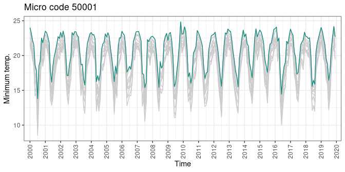

As an alternative option, we could also aggregate to a coarser spatial
unit by using an aggregation function. Here, we aggregate to meso areas
using the `aggregate_space` argument. Since `type="cov"`, it will
aggregate temperatures using the mean as a default.

``` r
plot_timeseries(
  dengue_MS,
  var = "tmin",
  type = "cov",
  var_label = "Minimum temp.",
  time = "date",
  unit = "micro_code",
  aggregate_space = "meso_code"
)
```

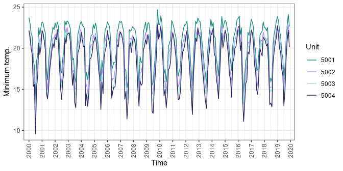

After temperature, we move on to plotting dengue counts (note
`type="counts"`) aggregating to meso areas using `aggregate_space`,
which applies a sum function by default when `type="counts"`. Given the
right-skewed distribution of the counts, we scale the y axis using a
`log10(x+1)` transformation:

``` r
plot_timeseries(
  dengue_MS,
  var = "dengue_cases",
  type = "counts",
  time = "date",
  unit = "micro_code",
  aggregate_space = "meso_code",
  transform = "log10p1"
)
```

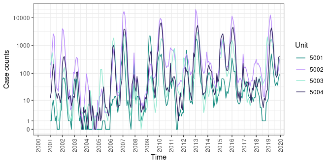

In a similar fashion, we can also plot incidence rates (note
`type="inc"` and the defined `pop` argument) aggregating to meso areas
using `aggregate_space`, which for `type="inc"` it first sums the cases
per area, and then computes the incidence rates. We set the scale of the
incidence rate (`pt` argument) to 1,000 persons, and scale the y axis
using a `log10(x+1)` transformation:

``` r
plot_timeseries(
  dengue_MS,
  var = "dengue_cases",
  type = "inc",
  pop = "population",
  time = "date",
  unit = "micro_code",
  aggregate_space = "meso_code",
  pt = 1000,
  transform = "log10p1"
)
```

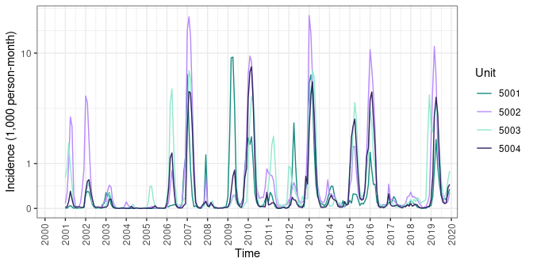

## Dual-axis time series

`plot_timeseries2` produces two-axis time series plots of covariates,
case counts, or incidence rates. Similarly to `plot_timeseries`, it
allows for spatial and temporal aggregations, plotting single or
multiple time series of different spatial units simultaneously using
facets, and axis and title labeling. The main difference between the two
time series functions is that, in `plot_timeseries2` the arguments
`var`, `type` and optionally `var_label` and `ylab` need to be of length
2, corresponding to the left and right axes respectively.

We start by plotting the time series data for two covariates (note
`type=c("cov", "cov")`): maximum temperature and PDSI. We choose to
align the two axis by forcing the mean of the two variables to be
aligned:

``` r
plot_timeseries2(
  dengue_MS,
  var = c("tmax", "pdsi"),
  type = c("cov", "cov"),
  time = "date",
  unit = "micro_code",
  align = "mean"
)
```

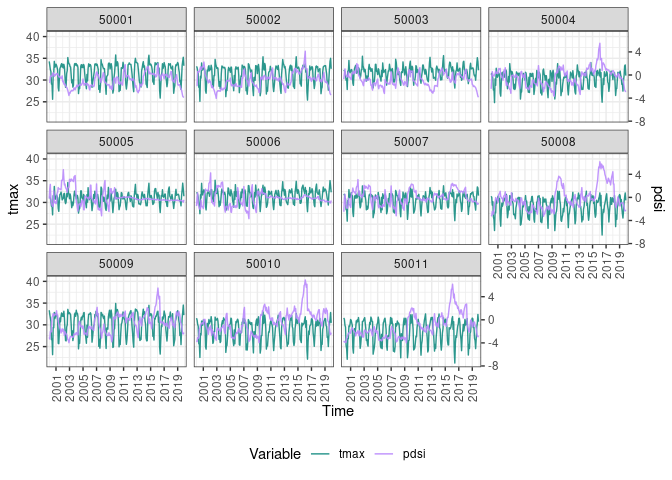

We now improve on this by performing spatial aggregation into larger
*meso* areas and specifying custom colours and labels:

``` r
plot_timeseries2(
  dengue_MS,
  var = c("tmax", "pdsi"),
  type = c("cov", "cov"),
  time = "date",
  unit = "micro_code",
  aggregate_space = "meso_code",
  palette = c("tomato", "royalblue"),
  var_label = c("Maximum temp.", "PDSI"),
  align = "mean"
)
```

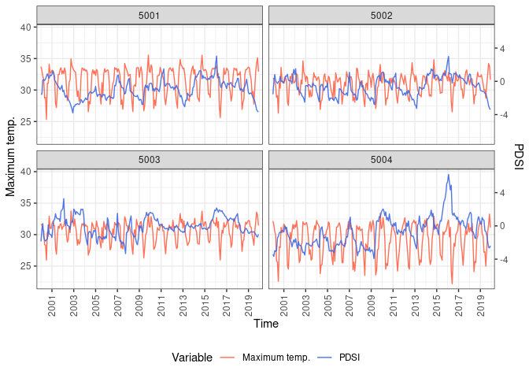

One of the most interesting applications of `plot_timeseries2` is to
visualize in the same graph disease cases and a candidate predictor. We
do that in the following example, where we visualize dengue incidence
and maximum temperature (note `type=c("inc", "cov")` and the `pop`
argument):

``` r
plot_timeseries2(
  dengue_MS,
  var = c("dengue_cases", "pdsi"),
  type = c("inc", "cov"),
  pop = "population",
  time = "date",
  unit = "micro_code",
  aggregate_space = "meso_code"
)
```

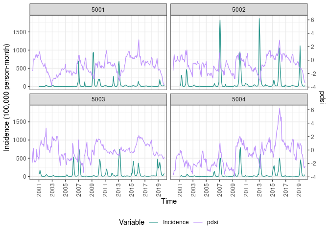

Similarly, we can visualize case counts together with a covariate (note
`type=c("counts", "cov")`).

``` r
plot_timeseries2(
  dengue_MS,
  var = c("dengue_cases", "pdsi"),
  type = c("counts", "cov"),
  time = "date",
  unit = "micro_code",
  aggregate_space = "meso_code"
)
```

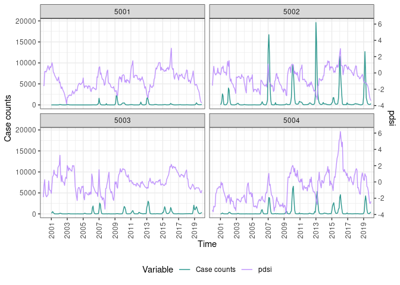

## Heatmap

`plot_heatmap` plots time series heatmaps of covariates, case counts, or
incidence rates. Years are displayed on the y axis and weeks or months
on the x axis. The function allows for spatial and temporal
aggregations, plotting single or multiple time series for different
spatial units simultaneously (using facets), color transformations, and
axis and title labeling.

In this first example, we plot the variable (note `type="cov"`) PDSI
(Palmer Drought Severity Index) aggregated at the meso code level. We
use a suitable palette for drought and we center it at zero:

``` r
plot_heatmap(
  dengue_MS,
  var = "pdsi",
  type = "cov",
  var_label = "PDSI",
  time = "date",
  unit = "micro_code",
  aggregate_space = "meso_code",
  palette = "-Vik",
  centering = 0
)
```

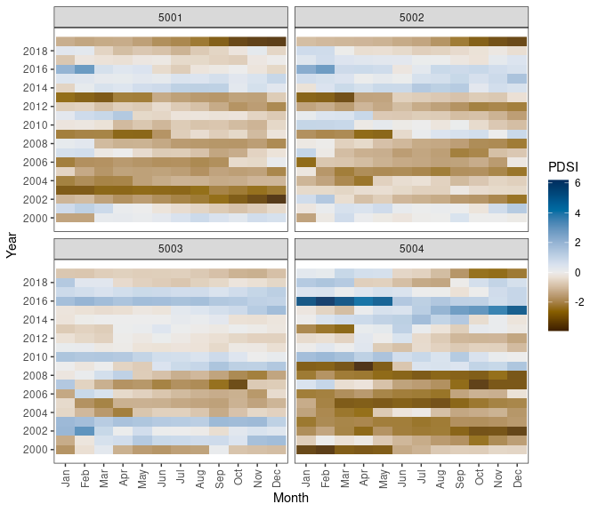

In this second example, we plot dengue incidence rates (note
`type="inc"` and `pop` arguments) at the meso code level and apply a
transformation to the color gradient to have a better contrast.

``` r
plot_heatmap(
  dengue_MS,
  var = "dengue_cases",
  type = "inc",
  pop = "population",
  time = "date",
  unit = "micro_code",
  aggregate_space = "meso_code",
  title = "Monthly Incidence",
  transform = "log10p1"
)
```

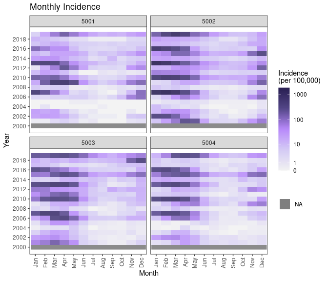

## Seasonality

`plot_seasonality` produces yearly time series of covariates, case
counts, or incidence rates to explore seasonality patterns. Months/weeks
are shown on the x axis, the magnitude of the variable on the y axis,
and years are represented as colors. The function allows for spatial and
temporal aggregations, plotting single or multiple time series of
different units simultaneously (using facets), axis transformations, and
axis and title labeling.

In this example, we explore the seasonal patterns of minimum temperature
aggregated at the meso code level.

``` r
plot_seasonality(
  dengue_MS,
  var = "tmin",
  var_label = "Minimum temperature",
  type = "cov",
  time = "date",
  unit = "micro_code",
  aggregate_space = "meso_code"
)
```

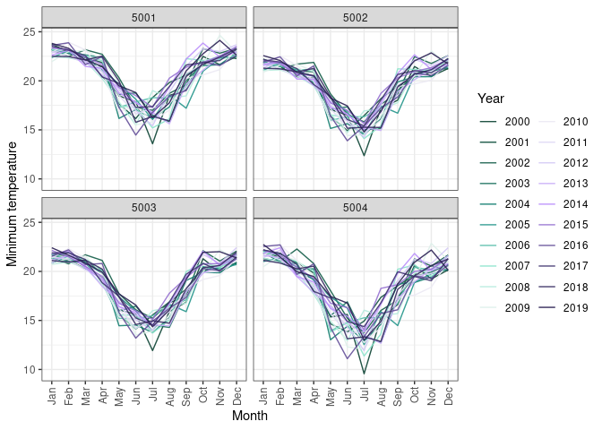

## Map

`plot_map` plots choropleth maps of covariates, case counts, or
incidence rates. In this function, we also need to supply the sf object
containing the polygon geometries in the `map` argument. We can use the
`map_unit` argument to specify the column in the `sf` object that
contains the unit identifiers to be merged to the `unit` column of the
data frame specified in `data`.

`plot_map` allows for temporal aggregations (by year or across all
years), color transformations, centering and binning (current options
include quantiles and equal interval), as well as title labeling. It can
plot both numerical and categorical variables.

In this first example, we plot average urbanicity levels (note
`type="cov"`) over the entire study period while using an inverted
palette:

``` r
plot_map(
  data = dengue_MS,
  var = "urban",
  time = "date",
  type = "cov",
  unit = "micro_code",
  map = map_MS,
  map_unit = "code",
  aggregate_time = "all",
  var_label = "Urbanicity",
  palette = "-Heat"
)
```

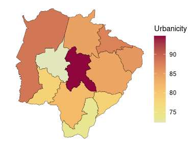

We now plot case incidence per 1,000 persons (note `type="inc"` and
`pt=1000`) for every year (`aggregate_time = "year"`) and binning into 5
categories using the quantile method (see `bins` and `bins_method`
arguments).

``` r
plot_map(
  dengue_MS,
  var = "dengue_cases",
  type = "inc",
  pop = "population",
  pt = 1000,
  time = "date",
  unit = "micro_code",
  map = map_MS,
  map_unit = "code",
  aggregate_time = "year",
  bins = 5,
  bins_method = "quantile",
  palette = "-Rocket"
)
```

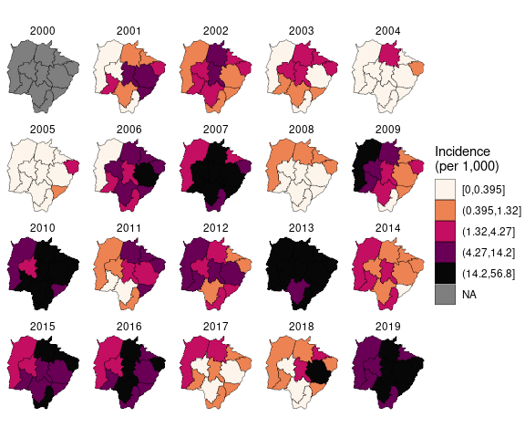

Lastly, here is one example with the categorical, time-invariant *biome*
covariate:

``` r
plot_map(
  data = dengue_MS,
  var = "biome_name",
  type = "cov",
  time = "date",
  unit = "micro_code",
  aggregate_time = "all",
  map = map_MS,
  map_unit = "code",
  var_label = "Biome"
)
```

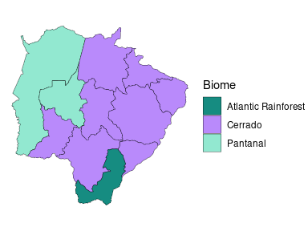

## Bivariate

`plot_bivariate` allows the visual assessment of associations between
two variables. It will be a scatter plot if both variables are numeric
and box plots if one of them is categorical. Options for customization
include grouping by a variable using color or facets (`unit` argument)
and axis and title labeling.

In this first example, we explore the relationship between maximum
temperature and drought while grouping by meso code:

``` r
plot_bivariate(
  dengue_MS,
  var = c("tmax", "pdsi"),
  var_label = c("Max. temp", "PDSI"),
  unit = "meso_code"
)
```

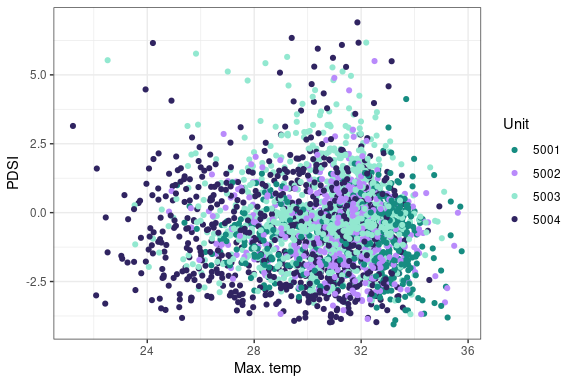

Next, we do the same but grouping using facets with free scales:

``` r
plot_bivariate(
  dengue_MS,
  var = c("tmax", "pdsi"),
  var_label = c("Max. temp", "PDSI"),
  unit = "meso_code",
  facet = TRUE,
  free_x_scale = TRUE,
  free_y_scale = TRUE
)
```

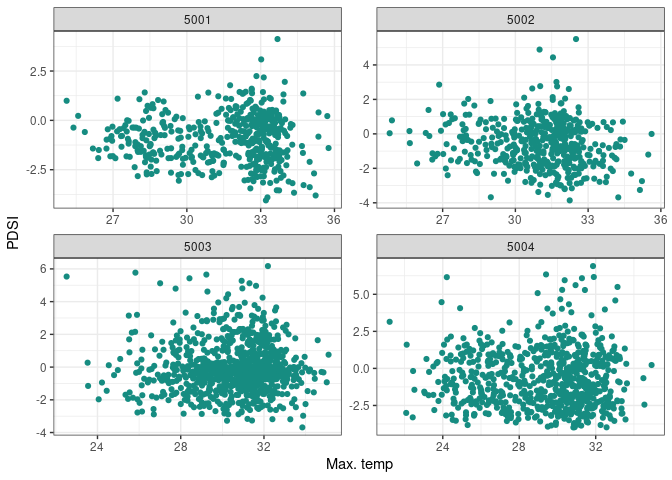

Lastly, we explore the distribution of minimum temperature and the
categorical variable biome while coloring by meso code:

``` r
plot_bivariate(
  dengue_MS,
  var = c("biome_name", "tmax"),
  var_label = c("Biome", "Max. temp"),
  unit = "meso_code"
)
```

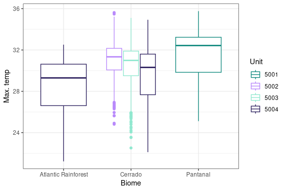

## Correlation

`plot_correlation` plots a correlation matrix of a set of variables. By
default, Pearson correlation is computed, and circles are used to depict
correlation values in the lower triangle and the diagonal of the matrix,
whereas numbering is used in the upper triangle:

``` r
plot_correlation(
  dengue_MS,
  var = c(
    "dengue_cases",
    "pop_density",
    "tmax",
    "tmin",
    "pdsi",
    "urban",
    "water_network",
    "water_shortage"
  )
)
```

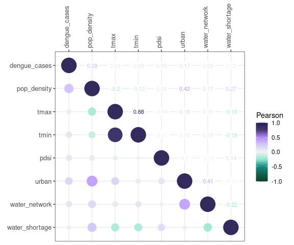

In this second example, we use Spearman correlation and customize the
triangles and the palette.

``` r
plot_correlation(
  dengue_MS,
  var = c(
    "dengue_cases",
    "pop_density",
    "tmax",
    "tmin",
    "pdsi",
    "urban",
    "water_network",
    "water_shortage"
  ),
  method = "spearman",
  plot_type = c("number", "raster"),
  palette = "RdBu"
)
```

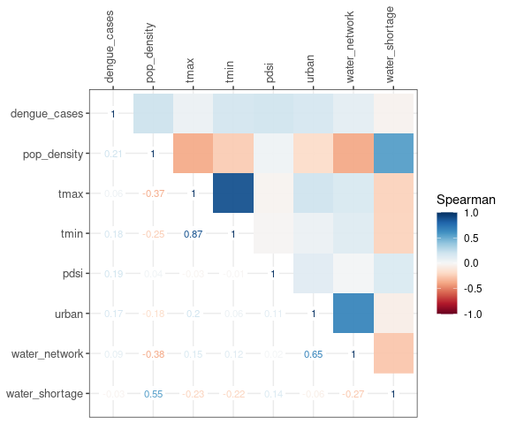

Custom labels for the variables can be provided using the `var_label`
argument.

## Cross-correlation

`plot_crosscorrelation` plots the correlation between two variables at
different lag times, and is typically used to assess the correlation
between a disease outcome and different lags of a covariate.

In this first example, we plot the Pearson correlation at lags 0-6
months between dengue incidence and maximum temperature (see `type =
c("inc", "cov")`) by micro area. Note that the second variable, i.e. the
covariate, is the one getting lagged:

``` r
plot_crosscorrelation(
  data = dengue_MS,
  var = c("dengue_cases", "tmax"),
  type = c("inc", "cov"),
  pop = "population",
  time = "date",
  unit = "micro_name",
  lags = 0:6
)
```

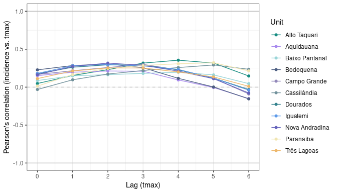

Similarly to the rest of the functions, we can perform spatial
aggregations and customize different aspects of the plot. We can also
choose another correlation metric as well (kendall or spearman).

``` r
plot_crosscorrelation(
  data = dengue_MS,
  var = c("dengue_cases", "tmax"),
  type = c("inc", "cov"),
  pop = "population",
  time = "date",
  unit = "micro_name",
  method = "spearman",
  aggregate_space = "meso_name",
  facet = TRUE,
  title = "Cross-correlation for meso areas",
  palette = "navy",
  lags = 0:6
)
```

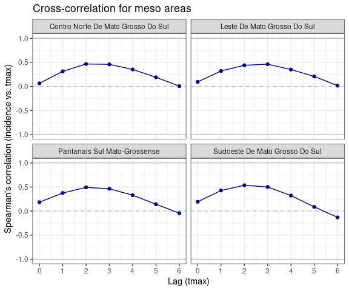

## Map animation

The function `animate_map` generates and writes to disk an animation in
`*.gif` format that displays the spatio-temporal time series in a
sequence of maps at different time points.

> 💡 **Tip**: The function `animate_map` requires two optional additional
> dependencies, `gganimate` and `magick`. Also, it may run into memory
> issues for long time series with lots of frames, especially when
> `ts_include = TRUE`. If this is the case, please use a shorter time
> series or reduce the figure size.

A basic usage of `animate_map` can be used to plot a covariate,
e.g. monthly minimum temperature in years 2002-2004:

``` r
animate_map(
  data = dengue_MS[dengue_MS$year %in% 2002:2004, ],
  var = "tmin",
  time = "date",
  unit = "micro_code",
  map = map_MS,
  map_unit = "code",
  type = "cov",
  palette = "Blue-Red 3",
  out_width = 400,
  out_height = 300,
  filename = "tmin.gif"
)
```

<div align="center">

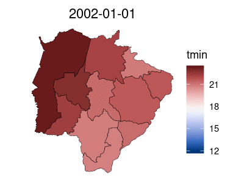

</div>

In this second example, we plot monthly case counts of dengue in years
2006-2007 and we add a synchronised time series plot with the number of
cases. Note that we can customise the resulting figure as usual but here
we have additional options such as the frame rate.

``` r
animate_map(
  data = dengue_MS[dengue_MS$year %in% 2006:2007, ],
  var = "dengue_cases",
  pop = "population",
  time = "date",
  unit = "micro_code",
  map = map_MS,
  map_unit = "code",
  type = "counts",
  fps = 2,
  ts_include = TRUE,
  transform = "log10p1",
  out_width = 500,
  out_height = 500,
  ts_color = "#453975",
  filename = "counts.gif",
)
```

<div align="center">
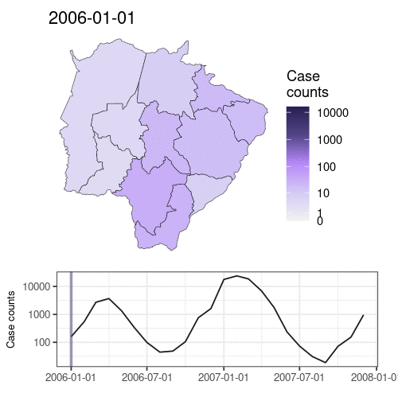
</div>

## Compare

`plot_compare` allows the visualization of several variables in the same
figure using the same **GHRexplore** plotting function. Possible
functions include `plot_timeseries`, `plot_heatmap`, `plot_seasonality`
and `plot_map`.

In `plot_compare`, the `var`, `var_lab`, `type` and `palette` can be
vectors of the same length that refer to each of the elements to be
plotted, while some other elements, like `pop`, `pt`, `time`, `unit` and
aggregation functions are shared. The final display of the multiple
plots is automatically done via the `cowplot` package, and several
options to arrange the figures are available (see `?plot_combine`)
including all arguments of `cowplot::plot_grid`.

In this first example, we plot the time series of PDSI and dengue
incidence as a single column and combine the legends (`ncol=1`,
`combine_legend=TRUE`):

``` r
plot_compare(
  plot_function = plot_timeseries,
  data = dengue_MS,
  var = c("pdsi", "dengue_cases"),
  type = c("cov", "inc"),
  var_lab = c("PDSI", "Dengue Incidence"),
  pop = "population",
  time = "date",
  unit = "micro_code",
  aggregate_space = "meso_code",
  ncol = 1,
  combine_legend = TRUE
)
```

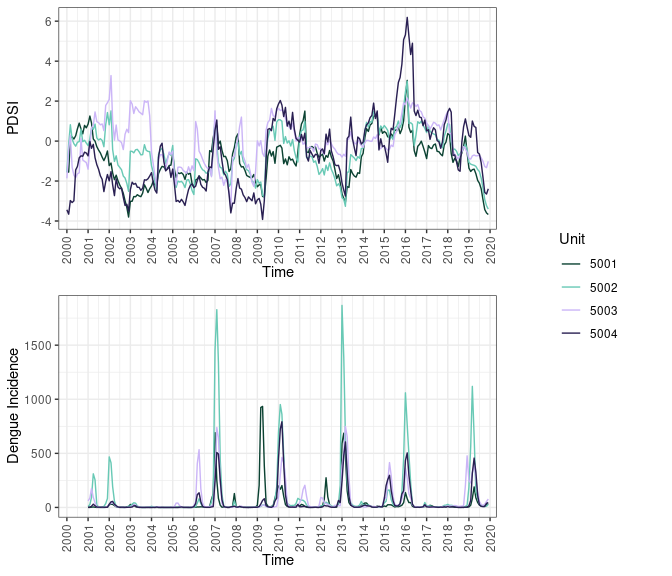

In this second example, we plot heatmaps of PDSI and dengue incidence
using different palettes:

``` r
plot_compare(
  plot_function = plot_heatmap,
  data = dengue_MS,
  var = c("pdsi", "dengue_cases"),
  type = c("cov", "inc"),
  var_lab = c("PDSI", "Incidence"),
  palette = c("Purp", "Reds"),
  pop = "population",
  time = "date",
  unit = "micro_code",
  aggregate_space = "meso_code",
  ncol = 1
)
```

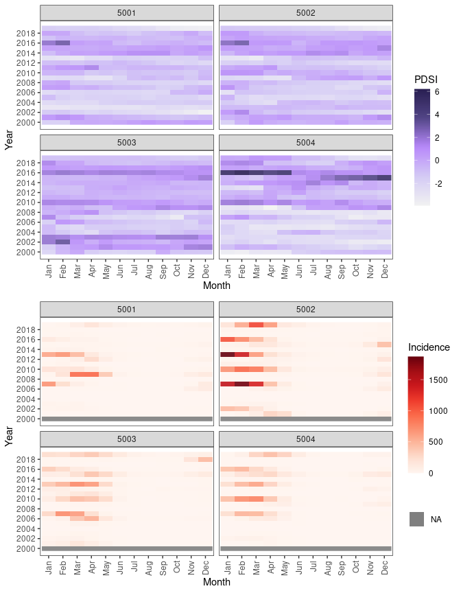
